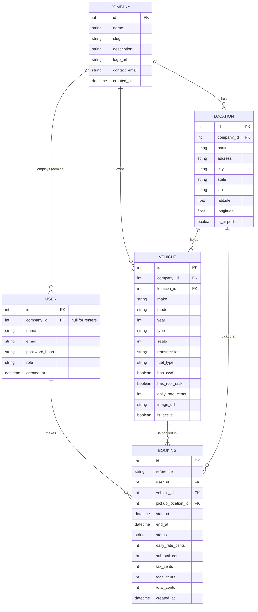

# Database Design (ERD)

## Fixed value lists (enums)

| Field | Allowed values |
|---|---|
| `User.role` | `RENTER`, `COMPANY_ADMIN`, `PLATFORM_ADMIN` |
| `Vehicle.type` | `ECONOMY`, `COMPACT`, `SEDAN`, `SUV`, `TRUCK`, `VAN`, `LUXURY`, `EV` |
| `Vehicle.transmission` | `AUTOMATIC`, `MANUAL` |
| `Vehicle.fuel_type` | `GAS`, `HYBRID`, `ELECTRIC` |
| `Booking.status` | `CONFIRMED`, `CANCELLED`, `COMPLETED` |

## Design decisions

1. **Multi-company from day one.** `Vehicle`, `Location` and `User` (admins)
   all carry a `company_id`. v1 ships with two seeded companies, but the
   model needs no changes to add more (see ADR 0001).

2. **Money is stored in cents as integers** (`daily_rate_cents`, etc.).
   Floating-point numbers cause rounding errors with currency.

3. **Booking stores a price snapshot.** If a company changes a daily rate
   tomorrow, existing bookings must keep the price the renter agreed to.

4. **Availability is calculated, not stored.** A vehicle is available for a
   requested range if no `CONFIRMED` booking overlaps it:
   `existing.start_at < requested.end_at AND existing.end_at > requested.start_at`.
   Cancelled bookings are ignored, so cancelling frees the vehicle (R7).

5. **Locations store latitude/longitude.** This powers both the map markers
   (R3) and the "nearest location" feature (R4).

6. **Renters have no company.** `User.company_id` is empty for renters and
   set for company admins. Role checks use `User.role`.

7. **Tax rate and fees are configuration, not hard-coded.** They will live
   in one place in the code so rates can be updated easily.

## Known limitations (v1)
- One pickup location per booking (no one-way drop-offs)
- No payments table (Stripe is a stretch goal)
- No reviews table