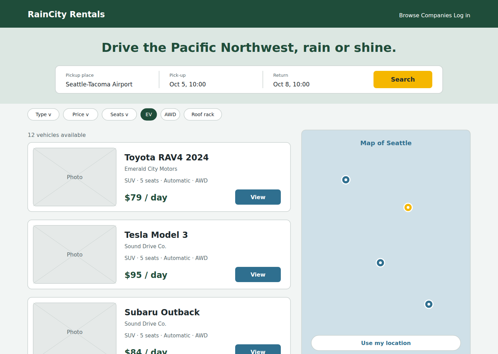
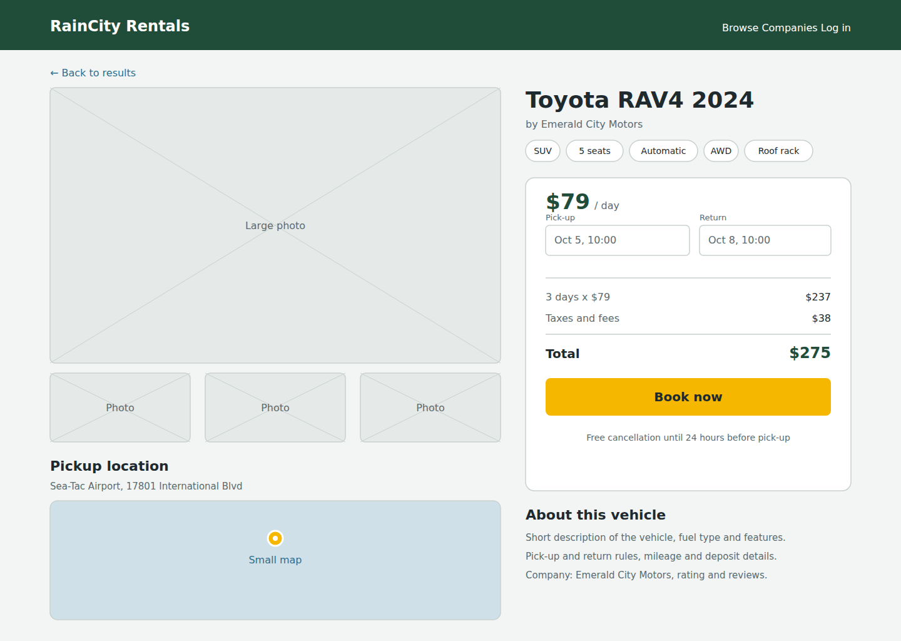
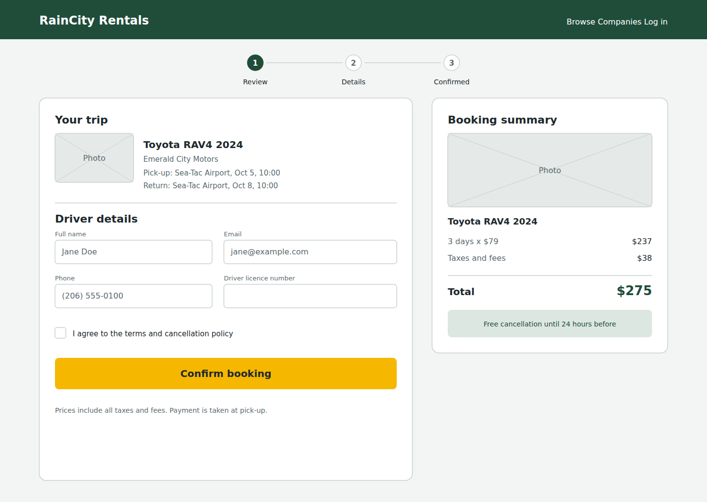
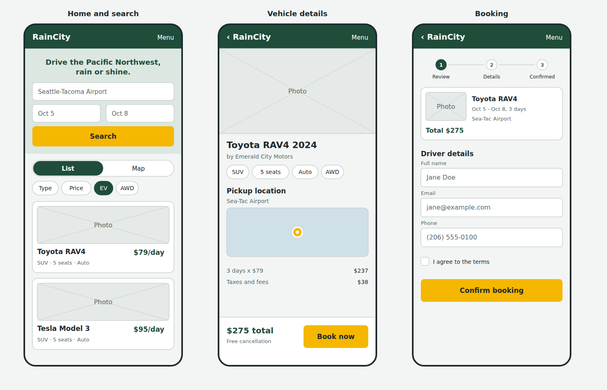

# Wireframes: RainCity Rentals

Low-fidelity layouts for the three core screens, informed by the
design research in [design-research.md](../design-research.md).

## 1. Home / Search with map

Covers: search by location and dates, filters, map of pickup locations,
nearest location (user stories R1-R4).

## 2. Vehicle details

Covers: vehicle info, pickup location map, sticky price summary
(R5, R6).

## 3. Booking

Covers: trip review, driver details, confirmation (R6, R7).

## Design notes
- **Palette:** evergreen `#1F4D3A`, Puget Sound blue `#2F6F8F`,
  misty grey `#F2F5F4`, warm yellow `#F5B700` for primary buttons
- **Font:** Inter
- **Mobile:** layouts stack vertically; the map and list switch with a toggle
- **Seattle touches:** EV / AWD / roof-rack filters and a Sea-Tac Airport
  pickup highlight

     ## 4. Mobile screens
   

   Home and search, vehicle details and booking, stacked for phones.
   The map and list switch with a List / Map toggle, and the price
   and "Book now" button stay pinned at the bottom of the details screen.